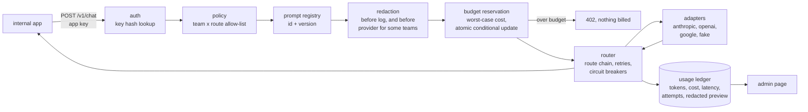

# llm-gateway

A small, production-shaped LLM gateway that gives internal apps one API across Claude, GPT and Gemini. It adds per-team model policies, monthly budgets, PII redaction before anything is logged, versioned prompts and fallbacks. **About 1 ms of overhead per request, every fallback case correct under injected failures, budgets never exceeded under concurrency, and none of 400 planted PII values in the logs.**

[](https://github.com/IbramGhali/llm-gateway/actions/workflows/ci.yml) [](LICENSE)

The problem: once a few teams use LLMs, each app holds its own provider keys and picks its own models. Personal data ends up in each app's logs, and nobody can say what is being spent or stop a runaway script. A gateway fixes that in one place:
- apps get one API and a key
- the platform team controls which models each team may use and what it may spend
- every request is redacted, costed and traceable
- provider outages are absorbed by fallbacks instead of breaking every app at once

> **Offline by default.** In the default `fake` mode every provider is a deterministic stand-in, so routing, retries, fallbacks, pricing and budgets run through the real code paths with no keys. The `demo-large` and `demo-flash` models are priced stand-ins that let the offline routes span three providers.

## At a glance

| | |
| --- | --- |
| Gateway overhead (zero-latency provider, SQLite) | **p50 0.9 ms, p95 1.6 ms** per request; p95 43 ms at 16 concurrent requests (SQLite serialises writes) |
| Fallback correctness | 5 of 5 failure cases correct over 250 requests; after an outage, the dead model received 3 calls instead of 100 |
| Budget enforcement | 200 concurrent requests on a $0.05 budget: 115 served, 85 refused, $0.0414 spent, no refused request reached a provider (also on Postgres) |
| PII in logs | 200 synthetic prompts, 400 planted values (email, phone, mobile, card, tax id, IP, IBAN): all redacted, **0 leaks**, 0 dollar amounts removed |
| Tests | 35 offline (15 unit, 7 contract, 9 integration, 4 evaluation), plus a Postgres test and a live-provider test run separately |
| Runs on | Windows, macOS, Linux; Python 3.11+; SQLite or Postgres; Docker Compose |

Every number comes from `uv run gw eval` on a fresh clone.

## Demo

An app calls a registered prompt by id. Its team (`support`) redacts prompts, so the email and phone number never reach the provider:

```bash
curl -s localhost:8080/v1/chat -H "Authorization: Bearer $KEY" -d '{
  "model": "fast",
  "prompt": {"id": "summarise-ticket", "variables": {
    "ticket": "Customer jo.smith@example.com says order 18842 arrived damaged; call 0412 345 678."}}}'
```

```json
{
  "id": "req_afe88c9399aa46ad",
  "model": "claude-haiku",
  "provider": "anthropic",
  "content": "...",
  "usage": {"input_tokens": 62, "output_tokens": 40, "cost_usd": "0.000026"},
  "latency_ms": 8.01,
  "fallback_used": false,
  "prompt": "summarise-ticket@v2",
  "attempts": [{"model": "claude-haiku", "outcome": "ok", "latency_ms": 0.04}]
}
```

When the primary provider is down, the same request is served by the next model in the route, and the response shows why:

```json
{"model": "demo-flash", "fallback_used": true, "attempts": [
  {"model": "claude-haiku", "outcome": "retryable_error", "detail": "anthropic 503"},
  {"model": "claude-haiku", "outcome": "retryable_error", "detail": "anthropic 503"},
  {"model": "demo-flash", "outcome": "ok"}]}
```

A team asking for a route it is not allowed gets a clear refusal, logged, with no provider call:

```json
{"id": "req_adb55f4319674e71", "error": "policy", "detail": "team support may not use smart"}
```

The admin page (`/admin`) shows each team's spend against budget, usage by team and model with p50/p95 latency, and recent requests with redacted previews only.

## How it works



1. **Authenticate.** The app key is hashed and looked up; only hashes are stored. Revoked keys stop working within 5 seconds (the length of the key cache).
2. **Policy.** The key's team must be allowed the requested route (`smart`, `fast`, `cheap`) or model.
3. **Prompt.** An optional `{id, version, variables}` reference renders a versioned template from `prompts/`. The version used is returned and recorded.
4. **Redact.** PII detectors run on the full prompt. The ledger keeps only a redacted preview and per-kind counts. Teams with `redact_prompts: true` also send the redacted text to the provider.
5. **Reserve budget.** The worst-case cost is reserved with one conditional `UPDATE` that cannot overshoot. That cost is estimated input plus `max_tokens` output, priced at the most expensive model in the route.
6. **Route.** The gateway tries the route's models in order.
   - Retryable errors (429, 5xx, timeouts) are retried up to twice.
   - Non-retryable errors move straight to the next model.
   - A per-model circuit breaker skips a model after 3 consecutive failures, for a 10-second cool-down.
7. **Settle and record.** The reservation becomes the actual cost. Tokens, latency, gateway overhead, attempts and the redacted preview are written to the ledger. If every model failed, the reservation is released and nothing is billed.

## Key decisions

| Decision | Why | ADR |
| --- | --- | --- |
| One normalised schema, adapters per provider | Apps never couple to a provider; routes can change models without app changes | [0001](docs/adr/0001-one-normalised-schema.md) |
| Policy and budgets in the gateway, with a worst-case reservation | Consistent limits, no concurrent overspend, refusals before any cost | [0002](docs/adr/0002-policy-and-budgets-in-the-gateway.md) |
| Redact before log, always | The gateway must not become the largest store of personal data | [0003](docs/adr/0003-redact-before-log.md) |
| Classified retries, fallback chains, per-model circuit breakers | Absorb outages without retrying hopeless requests or hammering a dead provider | [0004](docs/adr/0004-fallback-retry-and-circuit-breaking.md) |

## Quickstart

Needs [uv](https://docs.astral.sh/uv/). Offline, with no provider keys.

```bash
git clone https://github.com/IbramGhali/llm-gateway && cd llm-gateway
uv sync
uv run gw eval
uv run gw serve --demo          # creates demo apps; keys saved to .gw/demo-keys.json
uv run gw traffic               # in a second terminal; then open http://127.0.0.1:8080/admin
```

**With Docker and Postgres:**

```bash
docker compose up -d --build
docker compose run --rm traffic        # then open http://localhost:8080/admin
```

**Real providers:** set `GW_PROVIDER_MODE=live` plus any of `ANTHROPIC_API_KEY`, `OPENAI_API_KEY` and `GOOGLE_API_KEY`, and run `uv sync --extra anthropic --extra openai`. Providers without a key are skipped, and their routes fall back. Before enabling `gpt` or `gemini` for a team, fill in their prices in `config/gateway.yaml`; the config refuses to load otherwise.

**Create keys for real apps:** `uv run gw keys create <app-id> <team>`. The key is shown once, and only its hash is stored. `uv run gw keys revoke <app-id>` revokes it.

## Configuration

Models, routes and team policies are data in [config/gateway.yaml](config/gateway.yaml). Prompts are YAML files in [prompts/](prompts/).

| Setting | Default | Effect |
| --- | --- | --- |
| `models.<name>` | | Provider, provider model id, USD price per 1M input and output tokens (required to enable) |
| `routes.<route>` | `smart`, `fast`, `cheap` | Ordered fallback chain of catalogue models |
| `teams.<team>.allow` | | Routes and models the team may call |
| `teams.<team>.monthly_budget` | | USD; enforced before every request |
| `teams.<team>.redact_prompts` | `true` | Also strip PII before the provider sees the prompt |
| `GW_PROVIDER_MODE` | `fake` | `fake` (offline) or `live` |
| `GW_DATABASE_URL` | SQLite in `.gw/` | Any SQLAlchemy URL; Postgres needs the `postgres` extra |
| `GW_REQUEST_TIMEOUT` | `30` | Seconds per provider attempt |
| `GW_MAX_ATTEMPTS` | `2` | Attempts per model before falling back |

The API is described in [openapi.json](openapi.json). CI fails if it drifts from the code.

## Evaluation

`gw eval` runs four suites against the real gateway with fake providers.

**1. Overhead.** Time spent in the gateway, excluding the provider, with a zero-latency provider and an in-memory SQLite ledger:

| Mode | Requests | p50 | p95 | Throughput |
| --- | --- | --- | --- | --- |
| One request at a time | 500 | 0.9 ms | 1.6 ms | 667 req/s |
| 16 concurrent | 2,000 | 22 ms | 43 ms | 456 req/s |

The concurrent figure is mostly queueing on SQLite, which allows one writer at a time. The gateway serialises access to it on purpose (see the store's docstring). On Postgres no lock is needed, and the reservation is a single atomic update.

**2. Fallbacks under injected failures** (route `smart` = claude-opus, then demo-large, then claude-sonnet; 50 requests per case):

| Case | Served by | Failed cleanly (502) | Correct | Calls to the primary provider |
| --- | --- | --- | --- | --- |
| Primary healthy | claude-opus 50 | 0 | 50/50 | 50 |
| Primary outage | demo-large 50 | 0 | 50/50 | 3 (breaker opened) |
| Primary rejects the request (non-retryable) | demo-large 50 | 0 | 50/50 | 50 (no retries) |
| First two providers down | none | 50 | 50/50 | 6 (claude-opus and claude-sonnet share the provider) |
| Primary flaky (40% errors) | claude-opus 49, demo-large 1 | 0 | 50/50 | 80 |

**3. Budgets.** 200 requests, 16 at a time, from a team with a $0.05 monthly budget and large `max_tokens`:
- 115 served and 85 refused with HTTP 402
- $0.0414 spent, $0 left reserved
- provider calls equal served requests exactly, so no refused request cost anything

The same test runs on Postgres in CI, with 24 threads and no in-process lock.

**4. PII leakage.** 200 synthetic prompts, each with two planted values from seven kinds, sent through a team that does not redact prompts before the provider (the hardest case for logs):
- all 200 prompts are fully redacted
- none of the 400 values appears anywhere in the persisted ledger
- no dollar amount is removed

An early version of the phone detector also masked order numbers. A unit test caught it, and phone numbers now need a prefix.

**What these numbers do not show.** Provider latency and real token counts. Fake providers return instantly, and estimate tokens as about 4 characters each. Live behaviour of the three provider APIs is covered only by recorded-response contract tests and one optional live test.

**Gate.** `gw eval --gate` fails on:
- any PII leak
- any budget overrun, or a refused request reaching a provider
- fallback correctness below 100%
- per-request overhead p95 above 25 ms

CI runs it.

## Testing

| Tier | Count | What it covers |
| --- | --- | --- |
| Unit | 15 | Config validation (unknown models, unpriced models), Decimal cost maths, each PII detector, Luhn and amount preservation, the synthetic PII set, prompt registry versions and variables, circuit breaker states |
| Contract | 7 | Anthropic, OpenAI and Gemini translations against recorded responses (plus Gemini transport with a mock HTTP server), API auth, policy errors and error body shape, prompt reference recording, admin pages, committed OpenAPI spec equals the app |
| Integration | 9 | Outage fallback and breaker, half-open recovery, no retry on non-retryable errors, whole-route failure bills nothing, concurrent budget never exceeded, policy refusals never reach a provider, key revocation, PII absent from logs, redacting teams never send PII to the provider |
| Evaluation | 4 | The four eval suites with their correctness targets |
| Postgres | 1 | Concurrent budget enforcement on Postgres (CI service) |
| Live | 1 | One real provider call (`GW_LIVE_TESTS=1`) |

## Safety and governance

| Risk | Control | Where |
| --- | --- | --- |
| Unauthorised use | Hashed per-app keys, team binding, revocation | `store.py`, `gateway.py` |
| Teams using models they should not | Allow-list per team, checked before any provider call | `config/gateway.yaml`, `gateway.py` |
| Runaway spend | Worst-case reservation with an atomic conditional update; unpriced models cannot be enabled | `store.py`, `config.py` |
| Personal data in logs | Redact before log, always; preview only; optional redaction before the provider | `redaction.py`, `gateway.py` |
| Provider outages | Classified retries, fallback chains, per-model circuit breakers | `gateway.py`, `reliability.py` |
| Untraceable requests | Request id in every response and header; attempts and prompt version in the ledger | `schemas.py`, `store.py` |

## What changes at scale

- **State.** Postgres for the ledger and budgets (already supported). Circuit-breaker state and the key cache move to Redis so many replicas share them.
- **Streaming.** Server-sent events through the same schema; budgets settle on the final usage event.
- **Identity.** SSO for the admin page and per-user attribution (an app key plus a user header). Keys move to a secret manager with rotation.
- **Cost controls.** Per-request `max_tokens` caps per team, and alerts at 80% of budget. Prompt caching and batch routes for workloads that tolerate latency.
- **Redaction.** A named-entity model alongside the regex detectors, for names and addresses, measured on the same leakage suite.
- **Observability.** OpenTelemetry traces per request, with provider latency and overhead as separate spans.

## Known limitations and roadmap

- No streaming, tool use, images or structured outputs through the gateway yet (ADR 0001 explains why each needs explicit support).
- OpenAI and Gemini model prices are blank on purpose; fill them in from your price list before enabling those models.
- Regex PII detection does not catch names or street addresses.
- The breaker and the key cache are per process.
- The admin page has no authentication; run it on an internal network or behind SSO.

## Layout

```text
config/gateway.yaml    models and prices, routes, team policies and budgets
prompts/               versioned prompt templates
openapi.json           generated API description (checked in CI)
src/llm_gateway/
  gateway.py           the pipeline: policy, prompt, redaction, budget, routing, ledger
  providers/           adapters (Anthropic SDK, OpenAI SDK, Gemini REST) and the fake
  redaction.py         PII detectors
  reliability.py       per-model circuit breakers
  store.py             keys, budgets (reservation), usage ledger
  prompts.py           prompt registry
  api.py               FastAPI app and admin page
  evaluation.py        overhead, fallback, budget and PII suites
  cli.py               `gw` command
tests/                 unit, contract (with recorded fixtures), integration, evaluation, live
docs/adr/              architecture decision records
```

## AI assistance disclosure

Built with Claude Code as a pair programmer. I set the design, the decisions recorded in the ADRs and the evaluation approach, and I reviewed the code and checked every result.
